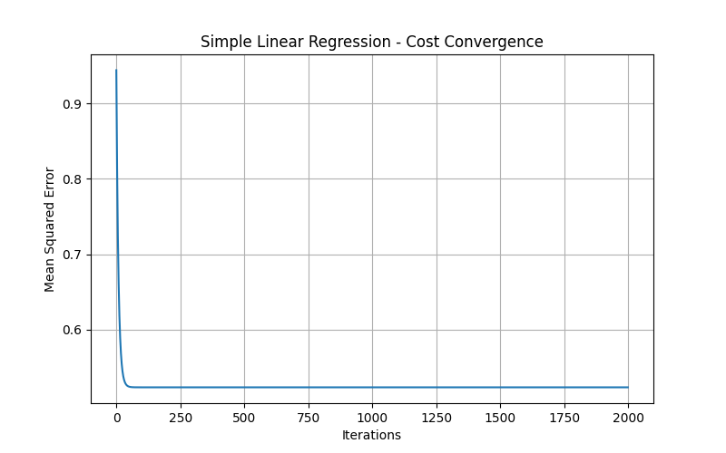
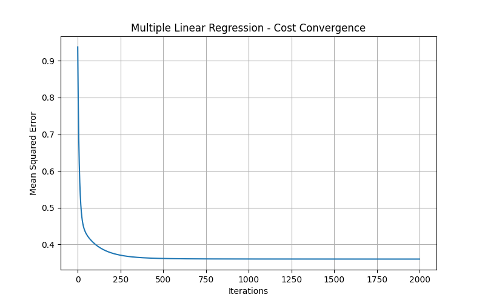

# Linear Regression From Scratch Using NumPy

## Project Overview

This project implements Simple Linear Regression and Multiple Linear Regression from scratch using Python and NumPy.

The objective is to understand how linear regression works internally by implementing the hypothesis function, Mean Squared Error (MSE), gradient calculation, and gradient descent without using Scikit-learn for model training.

The California Housing Prices dataset is used to predict median house values based on numerical housing features.

## Dataset

- **Dataset:** California Housing Prices
- **Source:** [Kaggle – California Housing Prices](https://www.kaggle.com/datasets/camnugent/california-housing-prices)
- **Records:** 20,640
- **Target variable:** `median_house_value`
- **Input features:** 8 numerical features

## Technologies Used

- Python
- NumPy
- Pandas
- Matplotlib
- Scikit-learn

Scikit-learn is used for data preprocessing, train-test splitting, and comparing the results with its built-in Linear Regression model. The actual regression implementation is done using NumPy.

## Project Structure

```text
Linear-Regression-From-Scratch/
│
├── dataset/
│   └── housing.csv
│
├── results/
│   ├── simple_cost_convergence.png
│   └── cost_convergence.png
│
├── linear_regression.py
├── main.py
└── README.md
```

## Implementation

### 1. Hypothesis Function

The hypothesis function predicts the output using input features and model parameters.

\[
\hat{y}=X\theta
\]

### 2. Mean Squared Error

MSE measures the average squared difference between actual and predicted values.

\[
J(\theta)=\frac{1}{m}\sum_{i=1}^{m}(\hat{y}^{(i)}-y^{(i)})^2
\]

### 3. Gradient Calculation

The gradient calculates how much each model parameter contributes to the prediction error.

\[
\nabla J(\theta)=\frac{2}{m}X^T(X\theta-y)
\]

### 4. Gradient Descent

Gradient descent updates the parameters iteratively to minimize the cost.

\[
\theta := \theta-\alpha\nabla J(\theta)
\]

Where:
- \(\theta\) = Model parameters
- \(\alpha\) = Learning rate
- \(m\) = Number of training samples

## Models Implemented

### Simple Linear Regression

Uses one input feature:

- `median_income`

### Multiple Linear Regression

Uses eight input features:

- longitude
- latitude
- housing_median_age
- total_rooms
- total_bedrooms
- population
- households
- median_income

## Data Preprocessing

- Split the dataset into 80% training data and 20% testing data.
- Handle missing values using median imputation.
- Standardize input features.
- Standardize the target variable during training.
- Add a bias column for the intercept.

## Model Evaluation

The models are evaluated using Mean Squared Error (MSE) and R² Score.

| Metric | Simple Regression | Multiple Regression |
|---|---:|---:|
| MSE | 7,091,157,771.77 | 5,040,443,742.51 |
| R² Score | 0.458859 | 0.615353 |

### Scikit-learn Comparison

The NumPy implementation is compared with Scikit-learn's LinearRegression model using the same training and testing split.

| Metric | NumPy Multiple Regression | Scikit-learn |
|---|---:|---:|
| MSE | 5,040,443,742.51 | 5,059,656,033.13 |
| R² Score | 0.615353 | 0.613887 |

The results are close, demonstrating that the NumPy implementation produces performance comparable to Scikit-learn on this dataset.

## Cost Convergence

The cost convergence graphs show how the Mean Squared Error decreases during gradient descent training.

**Simple Linear Regression**



**Multiple Linear Regression**



## How to Run the Project

1. Clone or download the repository.
2. Install the required libraries:

```bash
pip install numpy pandas matplotlib scikit-learn
```

3. Ensure the dataset is placed inside the `dataset` folder.
4. Run the following command:

```bash
python main.py
```

## Conclusion

This project demonstrates the implementation of Simple and Multiple Linear Regression from scratch using NumPy.

The results show that Multiple Linear Regression performs better than Simple Linear Regression for the selected dataset. The comparison with Scikit-learn also validates the correctness of the implementation.
